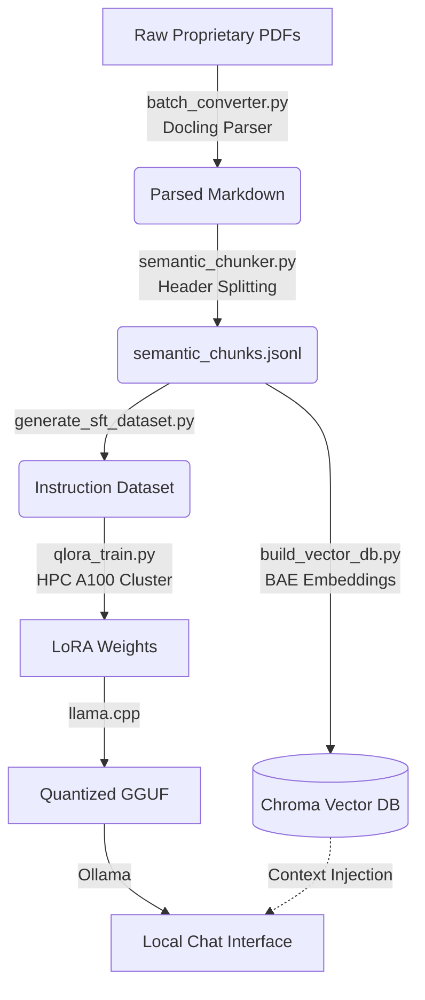

<div align="center">
  <h1>🛠️ EDA Coder</h1>
  <p><b>A hybrid RAG + QLoRA pipeline that translates plain-English hardware design intent into syntactically perfect Synopsys Tcl commands.</b></p>
</div>

<br/>

## 🌟 Overview

Physical design engineers using Synopsys tools (IC Compiler II, Design Compiler, etc.) spend thousands of hours digging through dense documentation to find the exact Tcl command syntax for complex routines. General-purpose LLMs hallucinate these commands because the manuals are proprietary. 

**EDA Coder solves this through a two-stage hybrid approach:**
1. **QLoRA Fine-Tuning (SFT):** We fine-tuned a base code model (`deepseek-coder-7b-base`) on a synthetic dataset extracted directly from the manuals to teach it Synopsys idioms.
2. **Retrieval-Augmented Generation (RAG):** At inference time, the user's query searches a massive local vector database of 23,000+ manual chunks. The retrieved context is injected into the LLM's prompt, guaranteeing perfect syntax and removing hallucinations.

---

## ⚡ Performance: RAG vs. Base SFT

We pit the Base Fine-Tuned Model against the full RAG Pipeline in a stress test. The results clearly demonstrate why RAG is necessary for complex EDA scripting:

| Query | Base SFT Model (No RAG) | EDA Coder (SFT + RAG) |
|---|---|---|
| *Create a floorplan with 0.7 utilization and 10 micron offset.* | ❌ `create_floorplan -core_utilization 0.7 -side_offset 10` (Hallucinated command & flags) | ✅ `initialize_floorplan -core_utilization 0.7 -shape R -orientation N -side_ratio {3.0 1.0} -core_offset {100.0} -flip_first_row true -coincident_boundary true` |
| *Place all macros first before placing standard cells.* | ❌ `set_app_options-nameplace.macro_first_in_placement_flow\-value1` (Hallucinated app option) | ✅ `set_app_options -list {plan.macro.style islands}` (Exact ICC2 syntax from manual) |

---

## 🏗️ Architecture Pipeline

The repository is structured to take you all the way from raw PDFs to a standalone, quantised Ollama deployment.



---

## 🚀 Quick Start (Deployment)

If you just want to run the model on your lab machines, you do not need to run the data processing or HPC training pipelines.

Simply grab the distributable package (`eda_coder_deploy`) and run the setup script:

```bash
# On Linux Lab Machines
chmod +x install_linux.sh
./install_linux.sh

# The script will load the GGUF into Ollama and start the chat interface:
source .venv/bin/activate
python tcl_inference.py
```

---

## 🛠️ Reproducing the Pipeline

If you wish to rebuild the dataset, re-train the model, or update the database with new manuals, follow these steps:

### Phase 1: Ingestion & Chunking
```bash
# 1. Convert PDFs to Markdown (Requires docling)
python batch_converter.py --pdf_dir ./synopsys_pdfs --out_dir ./parsed_markdown --num_threads 4

# 2. Chunk Markdown into semantic blocks
python semantic_chunker.py
```

### Phase 2: RAG Vector DB
```bash
# 3. Embed the chunks into ChromaDB (~28 min on CPU)
python build_vector_db.py
```

### Phase 3: HPC Fine-Tuning
```bash
# 4. Generate SFT instruction pairs locally
python generate_sft_dataset.py

# 5. Download model weights and dependencies for offline transfer
python download_hf_model.py
python download_hpc_wheels.py

# 6. Submit to Slurm on HPC
sbatch hpc_submit.slurm
```

### Phase 4: Quantization & Deployment
```bash
# 7. Merge LoRA weights and convert to GGUF using llama.cpp
# 8. Import to Ollama
ollama create eda-coder -f Modelfile
```

---

## 📜 Key Design Decisions

- **Docling for PDF Parsing:** Standard PDF parsers destroy code blocks and tables. `docling` reconstructs them perfectly using layout analysis.
- **Header-Level Chunking:** Standard token-based chunking splits Tcl scripts in half. We split purely on Markdown headers (`#`, `##`) to preserve code integrity.
- **`bge-small-en-v1.5` Embeddings:** Highly optimized for asymmetric retrieval (short questions matching against long manual pages).
- **Ollama GGUF backend:** Running a 7B parameter model in FP16 takes 14GB of VRAM. By quantizing to 4-bit (`Q4_K_M`) and running via Ollama, we can deploy the final RAG pipeline on standard lab machines with minimal hardware overhead.

---

> **Note:** The Synopsys PDF manuals and the resulting dataset are proprietary and cannot be open-sourced. This repository contains the framework and code necessary to build the pipeline on your own proprietary hardware documentation.
