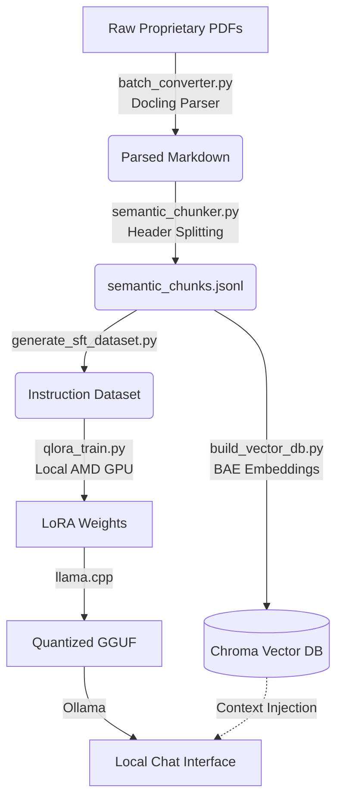

<div align="center">
  <h1>🛠️ EDA Coder</h1>
  <p><b>EDA Coder: A Localized LLM Pipeline for Syntactically Exact Command Generation for CAD Tools.</b></p>
</div>

<br/>

## 🌟 Overview

Physical design engineers using CAD tools (e.g., Synopsys IC Compiler II, Design Compiler, etc.) spend thousands of hours digging through dense documentation to find the exact command syntax for complex routines. General-purpose LLMs hallucinate these commands because the manuals are proprietary. 

**EDA Coder solves this through a two-stage hybrid approach:**
1. **QLoRA Fine-Tuning (SFT):** We fine-tuned a base code model (`deepseek-coder-7b-base`) on a synthetic dataset extracted directly from the manuals to teach it the specific CAD idioms.
2. **Retrieval-Augmented Generation (RAG):** At inference time, the user's query searches a massive local vector database of manual chunks. The retrieved context is injected into the LLM's prompt, guaranteeing perfect syntax and removing hallucinations.

While this pipeline can ingest any CAD tool manual and generate its respective command language, we use **Synopsys Tcl** in this repository as our primary evaluation example.

---

## ⚡ Performance: RAG vs. Base SFT

We pit the Base Fine-Tuned Model against the full RAG Pipeline in a stress test. The results clearly demonstrate why RAG is necessary for complex EDA scripting:

| Query | Base SFT Model (No RAG) | EDA Coder (SFT + RAG) |
|---|---|---|
| *Create a floorplan with 0.7 utilization and 10 micron offset.* | ❌ `create_floorplan -core_utilization 0.7 -side_offset 10` (Hallucinated command & flags) | ✅ `initialize_floorplan -core_utilization 0.7 -shape R -orientation N -side_ratio {3.0 1.0} -core_offset {100.0} -flip_first_row true -coincident_boundary true` |
| *Place all macros first before placing standard cells.* | ❌ `set_app_options-nameplace.macro_first_in_placement_flow\-value1` (Hallucinated app option) | ✅ `set_app_options -list {plan.macro.style islands}` (Exact ICC2 syntax from manual) |

---

## 🏗️ Architecture Pipeline

The repository is structured to take you all the way from raw PDFs to a standalone, quantised Ollama deployment.



---

## 📂 Repository Structure

```text
RAG_EDA/
├── eda_coder_deploy/         # Standalone deployment package
│   ├── install_linux.sh      # Setup script for Linux
│   ├── install_windows.ps1   # Setup script for Windows
│   ├── run_eda_coder.sh      # Runner for Linux
│   ├── run_eda_coder.ps1     # Runner for Windows
│   ├── README.md             # Deployment instructions
│   └── ...
├── parsers/                  # PDF Ingestion & Chunking
│   ├── batch_converter.py    # Docling PDF parser
│   ├── semantic_chunker.py   # Markdown header splitter
│   └── build_vector_db.py    # ChromaDB embedding script
├── training/                 # QLoRA Fine-Tuning
│   ├── generate_sft_dataset.py
│   └── qlora_train_local.py
├── eval/                     # Benchmarking & Ablation
│   ├── run_missing_benchmark.py
│   └── stress_test_suite.py
├── inference.py              # Core Interactive CAD Copilot UI
├── rag_retriever.py          # ChromaDB Context Retriever
└── docs_and_paper/           # VLSID 2027 Paper & Roadmaps
```

---

## 🚀 Quick Start (Deployment)

If you just want to run the model on your lab machines, you do not need to run the data processing or HPC training pipelines.

Simply grab the distributable package and:

```bash
# On Linux Lab Machines
chmod +x install_linux.sh
./install_linux.sh

# The script will load the GGUF into Ollama and start the chat interface:
chmod +x run_eda_coder.sh
./run_eda_coder.sh
```

---

## 🛠️ Reproducing the Pipeline

If you wish to rebuild the dataset, re-train the model, or update the database with new manuals, follow these steps:

### Phase 1: Ingestion & Chunking (`parsers/`)
```bash
cd parsers/
# 1. Convert PDFs to Markdown (Requires docling)
python batch_converter.py --pdf_dir ../synopsys_pdfs --out_dir ../parsed_markdown --num_threads 4

# 2. Chunk Markdown into semantic blocks
python semantic_chunker.py
```

### Phase 2: RAG Vector DB (`parsers/`)
```bash
# 3. Embed the chunks into ChromaDB (~28 min on CPU)
python build_vector_db.py
```

### Phase 3: Local Fine-Tuning (`training/`)
```bash
cd ../training/
# 4. Generate SFT instruction pairs locally
python generate_sft_dataset.py

# 5. Train using QLoRA natively on AMD GPU via WSL/Linux with ROCm
python qlora_train_local.py
```

### Phase 4: Evaluation (`eval/`)
```bash
cd ../eval/
# 6. Run the ablation study and benchmarking suite
python run_missing_benchmark.py
python stress_test_suite.py
```

---

## 📜 Key Design Decisions

- **Docling for PDF Parsing:** Standard PDF parsers destroy code blocks and tables. `docling` reconstructs them perfectly using layout analysis.
- **Header-Level Chunking:** Standard token-based chunking splits commands in half. We split purely on Markdown headers (`#`, `##`) to preserve code integrity.
- **`bge-small-en-v1.5` Embeddings:** Highly optimized for asymmetric retrieval (short questions matching against long manual pages).
- **Ollama GGUF backend:** Running a 7B parameter model in FP16 takes 14GB of VRAM. By quantizing to 4-bit (`Q4_K_M`) and running via Ollama, we can deploy the final RAG pipeline on standard lab machines with minimal hardware overhead.

---

> **Note:** The CAD PDF manuals and the resulting dataset are proprietary and cannot be open-sourced. This repository contains the framework and code necessary to build the pipeline on your own proprietary hardware documentation.
> This work has been accepted for presentation at VLSID 2027. The intellectual property associated with this work belongs to the authors and Shiv Nadar Institution of Eminence (SNIoE), subject to applicable publication agreements and institutional policies. Please do not reproduce, redistribute, or reuse this work without appropriate authorization and attribution.
